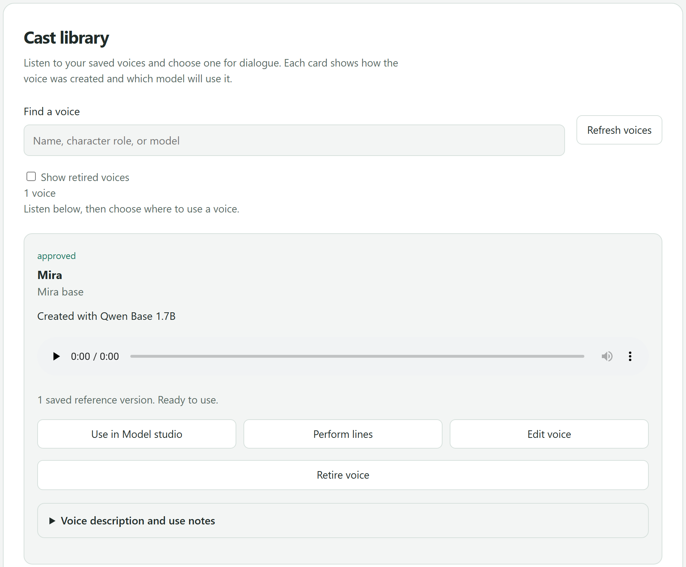
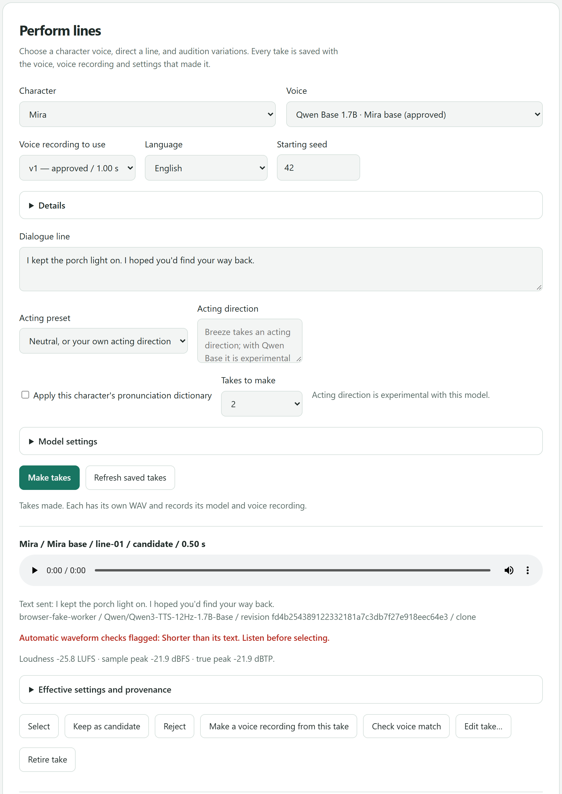
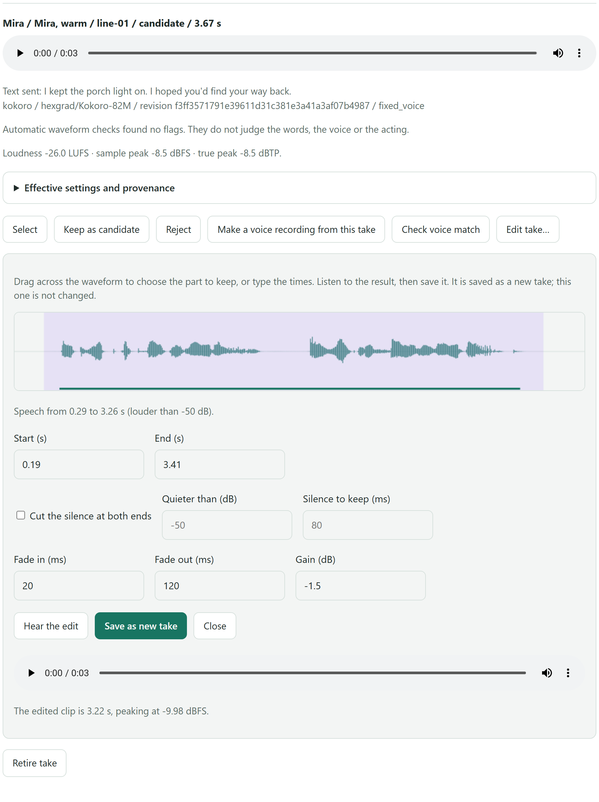
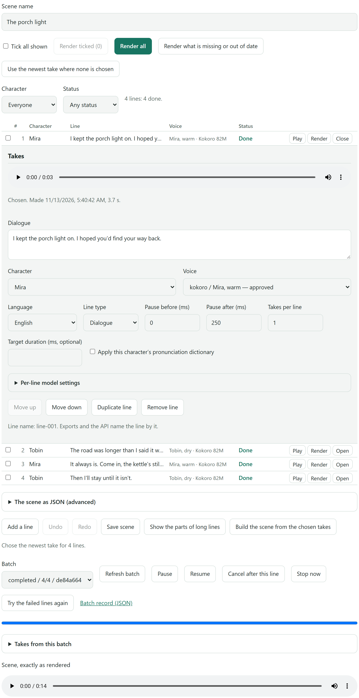
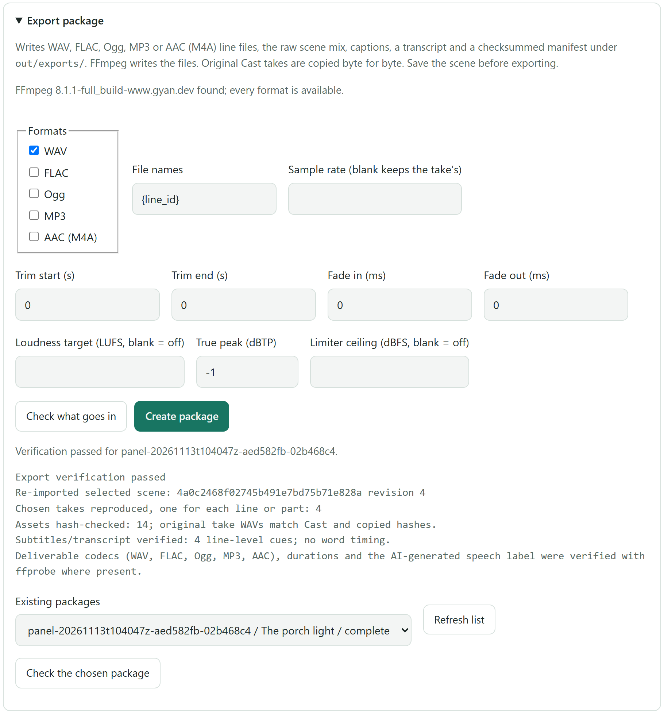

# Fel's Voice Lab

A local studio for character voices on Windows. Design or clone a voice, approve it as a character
in your Cast, act dialogue with it, render whole scenes as batches, compare takes blind, and export
production audio with a checksummed manifest. It runs on your own computer: the service listens only
on `127.0.0.1`, and the model workers run offline, so nothing is downloaded while you generate.

## Quick start

On Windows 10 or 11, with nothing installed first (not even Python):

1. Download `FelsVoiceLab-Setup-<version>.exe` (70 MB) from the newest release on the
   [Releases page](https://github.com/Fel101/fels-voice-lab/releases) and run it. It is not signed yet, so Windows SmartScreen
   warns about it: press **More info**, then **Run anyway**.
2. Press **Next** until **Install**. It installs for you alone, with no administrator prompt and no internet, and opens the Lab
   when it is done. It took 70 seconds here.
3. **Model studio** says that no voice model is installed yet. Press **Install Kokoro 82M**, read what it will do, and press
   **Install now**. It downloads 0.6 GB and took 5 minutes here, most of it unpacking Python packages. On a computer with
   a graphics card, Kokoro's card is set to install its GPU build instead, 2.0 to 2.4 GB, which took 7 minutes here; set it
   to **CPU** in **Models & features** first for the smaller one.
4. When it finishes, the studio is ready to speak, with a sentence in the box. Press **Generate**. The first sentence took 11
   seconds here, most of it loading the model (26 seconds with the GPU build); after that a sentence takes about a second.

From starting Setup.exe to the first sentence took about 6½ minutes with the CPU build and 9 with the GPU build, measured on
12 November 2026 on the development PC (an AMD mini PC with a Radeon AI PRO R9700, Windows 11), with nothing in pip's cache.
A slower connection or disk takes longer.

**An early release (0.2.0) for Windows 10/11 and Python 3.12.** It runs from source: Setup.exe or `setup.bat` sets up the core
and the desktop window, the speech models install from the page or with `setup.bat`, and each model runs in a Python environment
of its own. It was built and checked on one Windows machine with an AMD GPU, and every NVIDIA build the installers offer was
checked on a laptop with a GeForce RTX 5070 Laptop GPU (8 GB). There are no Linux or macOS results. Original application code
is MIT; borrowed code and optional models keep their own licenses. See [third-party terms](THIRD_PARTY_NOTICES.md).

## Hear it

[**Listen to a 40-second scene**](docs/demo/kokoro-demo.mp3) (MP3, 250 KB) in six of Kokoro 82M's preset voices: American,
British, Spanish and French. The Lab spoke every line on a mini PC's processor, with no graphics card and no cloud service; no
person's recording was used or cloned. Its [manifest](docs/demo/kokoro-demo.json) lists the lines, the voices, the model's pinned revision
and the file's SHA-256. Like every file the Lab makes, the clip says inside it that it is AI-generated speech.

## A look at it

The pictures below are made by the project's own browser test
([`tests/test_browser_flow.py`](tests/test_browser_flow.py)), which drives the real page in headless
Microsoft Edge or Google Chrome. Its engines are stand-ins that return a plain tone, so no model is
loaded and nobody's voice appears. Mira is a character that exists only in that test, every waveform
is a test tone, and the red note in the second picture is the automatic check noticing that a
half-second tone is shorter than its sentence.

### Cast library



Every saved voice is a card that shows how it was made, which model will speak for it, a saved
audition to play and how many saved reference versions it has. A reference version never changes
once saved, and keeps its transcript, origin and allowed use. Approving a voice records your
decision to use it; it cannot prove that you have the right to.

### Perform lines



Pick a character and voice, write or paste a line, optionally add an acting instruction, and make a
set of takes on consecutive seeds. Every take is saved with the text, model, reference and settings
that produced it, shows its loudness and peak readings, and carries automatic waveform checks for
silence, clipping, long pauses and audio much shorter than its text. The checks never judge the
words, the likeness or the acting: you still listen.

### Edit a take



**Edit take…** opens an editor under the take. Drag across the waveform or type times to trim, cut
the silence at both ends, add fades and a gain, listen with **Hear the edit**, then **Save as new
take**. The original is never changed, and the new take records what was done to it.

### Scenes and batch



A scene is a script of lines, shown as a table: each line has its own character, voice, voice
recording, language, pauses and settings, and a status that says whether it is rendered, chosen, failed
or out of date. **Render all**, **Render ticked** or a row's **Render** makes the takes as a batch that
runs one take at a time, can be paused, cancelled and retried, and picks up again after a restart. You
choose the take for each line, or the newest for every line at once, and assemble a preview. Undo, redo
and the usual shortcuts work on the script. A script you already have, in plain text (`NAME: words`)
or Fountain, becomes a scene once you give each speaker a voice.

### Export package



The export panel writes WAV, FLAC, Ogg, MP3 or AAC (M4A) line files, the raw scene mix, captions, a
transcript and a manifest of checksums into `out/exports/`, and never overwrites an existing package.
FFmpeg writes the files; the original Cast takes are copied byte for byte. **Verify** reads the
package back and checks every hash, the captions, and each file's codec and length.

## What it does

- **Model studio:** fixed voices, supported voice blends, descriptions, cloning, presets, playable
  reference details and model-specific controls.
- **Voice cloning:** browse for a recording or record one locally, listen, document its source and
  allowed use, save it as a named Cast candidate and generate a test line.
- **Cast and Perform:** voice cards with audio previews and model labels, a search box,
  immutable reference versions with transcripts and provenance, approvals, pronunciation, saved
  performances, seed variants, take review with loudness and peak readings, and a take editor that
  saves each edit as a new take.
- **Scenes and batch:** script import from plain text and Fountain, line names, long lines split
  into parts, sequential jobs with pause, resume, cancel
  and retry, stale-take protection, undo and redo, and previews.
- **Compare and export:** blind A/B listening on saved Cast takes, measurements, optional transcript
  and speaker proxies, packages in five formats with manifests and captions, and lip-sync tracks.
  Every file the Lab makes is labelled inside it as AI-generated speech; your own recordings never are.
- **Drama studio:** up to sixteen reference speakers, inline cues, long scripts, incremental PCM
  audition, retained jobs and mixed-audio packages.
- **System and backups:** the version, FFmpeg, free disk space and model states in one place, a
  report to paste into a bug report, folder sizes with a cleanup, and a one-file library backup that
  is read back and checked when it is written and restored into a new folder without touching the
  library in use.
- **Retire, or delete for good:** stop a voice, recording or take, and everything made from it, from being
  used again without deleting its audio, or delete it for good after a confirmation.
- **From a script:** a documented local HTTP API and a small command-line tool.
- **Other tools:** voice conversion, consent-aware import of clips kept by
  [Fel's Voice Slate](https://github.com/Fel101/fels-voice-slate), the companion recorder, and dataset
  preparation. Nothing here trains or fine-tunes a model.

## Models

Integrated families are Kokoro, Phonon 31M English, Chatterbox Original/Turbo/VC, Breeze TTS 2, Qwen3-TTS
VoiceDesign/Base/CustomVoice, VoxCPM2 and Fish Audio Drama 3. *Integrated* means the adapter and the
interface exist. The **Models & features** page says whether a family is *installed* (its
environment and pinned files are on disk) and *usable* (a test on your device loaded it and it
spoke one sentence), shows how much free RAM each family needs, and can install every one of them for you (the Qwen3-TTS
models, VoxCPM2 and Breeze TTS 2 only on a computer with a graphics card, an NVIDIA card or an AMD Radeon).
Which languages and devices were actually tried is written down in
[capabilities and limits](MODEL_CAPABILITIES.md) and the [language screen](docs/LANGUAGE_MATRIX.md).

Drama studio and all Drama cloning use CPU after a local Vulkan device-loss incident. Experimental
short GPU design is an opt-in local configuration; do not enable GPU cloning. Previous-take editing,
speaker stems and native word timing are not exposed by the pinned backend. Built with Fish Audio.

Kokoro presets are licensed model speaker packs, not uploaded recordings. Phonon's 37 preset voices
come from a repository that states no licence, so ask Gradium before you publish audio made with one.
See [voice assets and redistribution](docs/VOICE_ASSET_RIGHTS.md) before publishing recordings,
generated voices or model files with your project.

Voices belong to people. Clone only recordings you made yourself or whose speaker and rights holder
allow it, keep the transcript, origin and permission with each reference, and do not use the
software for deceptive impersonation or fraud. [Responsible use](docs/RESPONSIBLE_USE.md) says more.

## Other ways to set it up

1. Setup.exe ([Quick start](#quick-start)) installs into `%LOCALAPPDATA%\FelsVoiceLab` unless you choose
   another folder, with its own Python and the packages of the core and the desktop window.
   [Verify a download](SECURITY.md#verify-a-download) says how to check the file first. Or download the release's ZIP, or
   clone the repository, into a folder OneDrive does not sync, such as `C:\voice-lab`, and run `setup.bat`. There is no Python
   to install first: when the computer has no Python 3.12, setup downloads one for the Lab alone (about 14 MB) into its
   `python` folder.
2. Setup.exe opens the Lab when it is done; install the speech models from **Models & features**. `setup.bat` sets up the
   core and the desktop window, then asks which speech models to install: **Kokoro and Phonon**, which speak
   in 78 preset voices on any computer (about 0.8 GB to download and 2 GB on disk), or those and **Chatterbox Turbo**, which
   also speaks in the voice of any recording longer than five seconds (about 4 GB to download and 7 GB on disk, for a computer
   with 16 GB of RAM or more). It shows every model's plan and asks once. On a computer with an NVIDIA driver, or an AMD
   Radeon card, it offers the GPU builds too, each where it runs on the card.
3. Open **Fel's Voice Lab** from the Start menu (Setup.exe) or the desktop icon (`setup.bat`). Its dedicated window runs
   without a console; closing it stops its backend.

To add a model later, press **Install** on its card in **Models & features**, or run its launcher, such as `setup-kokoro.bat`,
`setup-phonon.bat` or `setup-chatterbox.bat`. Every model has one; the Qwen3-TTS models, VoxCPM2 and Breeze TTS 2 install only
for a graphics card, an NVIDIA card or an AMD Radeon. The core alone opens the studio and manages its stores, but it cannot speak
without a model.
[Setup](docs/SETUP.md) covers every installer and the other models, and [troubleshooting](docs/TROUBLESHOOTING.md) says what
runs on an 8, 16 or 32 GB computer and what to do when something stops.

FFmpeg is not bundled. Scene export, reference cleaning and M4A references need it: **Install FFmpeg** on **System &
backups** puts a pinned build in the Lab's own `ffmpeg` folder, and an FFmpeg you installed yourself
(`winget install Gyan.FFmpeg`) works too. Choose **Light**, **Dark** (neutral grey), **Forest** (dark green) or **System** from
the header's **Theme** menu; the choice is saved locally. **Check for updates** on **System & backups** says when a newer
release is out, and `update.bat` installs it with the Lab closed, keeping your library and models
([Updating the Lab](docs/SETUP.md#updating-the-lab)). To remove the Lab, see [Removing the Lab](docs/SETUP.md#removing-the-lab).

Browser mode, without the desktop window:

```powershell
.venv\Scripts\python.exe serve.py --port 8768
```

Open `http://127.0.0.1:8768/`. Closing a browser tab does not stop a foreground service. The desktop
launcher owns a separate backend on a free port and never closes independently started services.
Read [desktop and state behavior](docs/SETUP.md).

## Documentation

| Guide | Purpose |
|---|---|
| [Setup](docs/SETUP.md) | Environments, hardware, desktop launch, known installation limits, updating and removing the Lab |
| [Troubleshooting](docs/TROUBLESHOOTING.md) | What runs on which computer, setup and RAM problems, graphics cards, updates, FFmpeg, reporting a problem |
| [User guide](docs/USER_GUIDE.md) | Design through delivery, stopping and backups |
| [Architecture](docs/ARCHITECTURE.md) | For contributors: the processes and environments, a request's path, where things are decided |
| [Capabilities](MODEL_CAPABILITIES.md) | Integrated features versus trials and blocked models |
| [Language screen](docs/LANGUAGE_MATRIX.md) | Languages each engine was screened in, with word error rates and the hardware used |
| [Drama](docs/DRAMA3.md) / [production studio](docs/DRAMA3_EXPANSION.md) | Native runtime, cast, streaming and editing limits |
| [Voice Slate bridge](docs/RECORDER_BRIDGE.md) | Importing clips kept by Fel's Voice Slate: consent and identity checks |
| [Scene schema](docs/scenes/scene-schema-v1.md) | Scripts, stable IDs and selection rules |
| [HTTP API](docs/API.md) | Calls for scripts and other programs: speak, speak as a Cast voice, the command-line tool, and [`openapi.json`](openapi.json) |
| [Responsible use](docs/RESPONSIBLE_USE.md) | Recording/voice rights and output restrictions |
| [Changelog](CHANGELOG.md) | What is in this release, and its known limits |

## Verify

```powershell
.venv\Scripts\python.exe -m unittest discover -s tests -p "test_*.py" -v
node --test tests/ui_workspace.test.cjs tests/drama3_studio.test.cjs tests/theme.test.cjs tests/voice_workflows.test.cjs tests/voice_library.test.cjs tests/compare_cast.test.cjs tests/cast_reference_ui.test.cjs tests/engine_status.test.cjs tests/scene_history.test.cjs tests/take_edit_ui.test.cjs tests/updates_ui.test.cjs tests/queue_ui.test.cjs
.venv\Scripts\python.exe tools/check_repo.py
```

The last command checks the repository's files: it fails on obvious secrets, personal home paths, recordings, databases, logs and
model files, and on Markdown links to pages that are not in the repository.
The browser flow test in `tests/test_browser_flow.py` drives the page in headless Microsoft Edge or Google Chrome
when one is installed, and is skipped otherwise. Set `VOICE_LAB_BROWSER` to a browser path, and
`VOICE_LAB_BROWSER_SHOTS` to a folder to keep a picture of the working part of the page at each stage;
the screenshots above, in `docs/images/`, were made that way.
See [contributing](CONTRIBUTING.md) and [security](SECURITY.md). Optional-model tests report skips when assets are absent;
passing contract tests do not establish voice quality on every device/language.

## License

[MIT](LICENSE) for original application code, with [Apache notices](NOTICE) for
adapted components. Model licensing is separate: Breeze weights/self-hosted outputs
are non-commercial, and Drama has conditional commercial and hosted-service terms.
Check the full upstream licenses and recording permissions for your use. No model
weights or voice recordings are bundled. The one generated sample, the demo above, is
Kokoro's own preset voices (Apache-2.0), described in its manifest. No affiliation with
or endorsement by the model publishers is implied.
